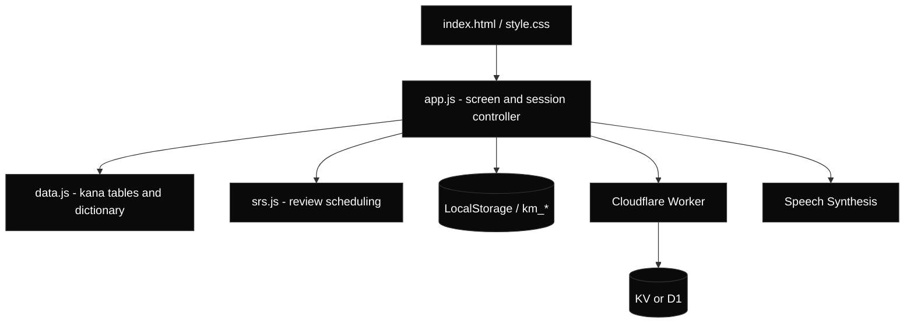
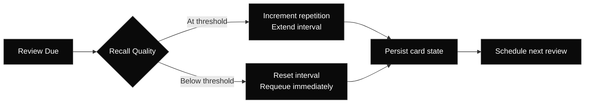
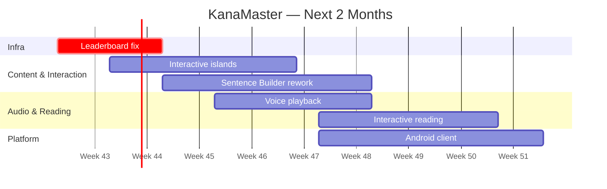

<div align="center">
  <br/>
  <svg width="96" height="96" viewBox="0 0 96 96" fill="none" xmlns="http://www.w3.org/2000/svg" role="img" aria-label="KanaMaster">
    <rect width="96" height="96" rx="20" fill="#000000"/>
    <rect x="0.5" y="0.5" width="95" height="95" rx="19.5" stroke="#FFFFFF" stroke-opacity="0.08"/>
    <text x="48" y="62" text-anchor="middle" font-family="serif" font-size="46" fill="#FFFFFF">あ</text>
    <circle cx="72" cy="24" r="5" fill="#C5F03A"/>
  </svg>
  <br/><br/>
  <h1>KanaMaster</h1>
  <p><strong>Japanese Writing System Trainer with Spaced Repetition</strong></p>
  <p>
    
    
    
    
    
    
  </p>
  <br/>
</div>

---

## Overview

KanaMaster is a client-side Japanese learning application focused on the systematic acquisition of Hiragana and Katakana. Instead of passive memorization, it combines active recall, timed recognition, motor-memory training and spaced repetition in a single interface.

The project is dependency-free at the application layer: plain JavaScript, hand-written CSS, local persistence and an optional Cloudflare Workers endpoint for the global leaderboard. There is no bundler, no package manager and no framework to configure.

**Design principles**

- Local-first: progress and settings live in the browser under the `km_` namespace.
- Zero build pipeline: edit a file, reload the page.
- Multi-modal recall: the same character is tested through recognition, input and writing.
- Deterministic scheduling: review timing is derived from recall quality, not randomness.

---

## Table of Contents

- [System Architecture](#system-architecture)
- [Core Modules](#core-modules)
- [Testing Vectors](#testing-vectors)
- [Learning Data](#learning-data)
- [Spaced Repetition](#spaced-repetition)
- [State and Persistence](#state-and-persistence)
- [UI and Design System](#ui-and-design-system)
- [Getting Started](#getting-started)
- [Project Structure](#project-structure)
- [Leaderboard Setup](#leaderboard-setup)
- [Roadmap](#roadmap)
- [Contributing](#contributing)
- [License](#license)

---

## System Architecture



The application layer never blocks on the network. Training, dictionary lookup and review scheduling work without a backend; only the leaderboard requires connectivity.

---

## Core Modules

| Module | Source | Purpose | Cognitive Target |
| :--- | :--- | :--- | :--- |
| **Kana Drill** | `app.js` | Randomized Hiragana and Katakana sessions with configurable character sets | Pattern recognition |
| **SRS Review** | `srs.js` | Interval-based rescheduling of previously learned characters | Long-term retention |
| **Dictionary** | `data.js` | Trilingual lookup with kana, romaji, English and Russian glosses | Semantic mapping |
| **Sentence Practice** | `data.js` | Curated sentence templates for contextual usage | Syntax and word order |
| **Stroke Order** | `app.js` | Canvas-based handwriting input | Motor memory |
| **Leaderboard** | `app.js` | Global ranking fetched from the Worker endpoint | Motivation |
| **Settings** | `app.js` | Session length, active testing methods, profile identity | Training control |
| **Session Engine** | `app.js` | Question generation, answer validation, scoring and state transitions | Recall under load |

---

## Testing Vectors

Testing methods are selectable in Settings. A training session samples only the enabled vectors, so a single character is never learned through one isolated pathway.

### 01 — Q / E Time Attack

Two candidate readings are presented. The learner answers with `Q` or `E` under a time constraint. Targets reflex-level recognition rather than deliberate recall.

### 02 — Flashcard

The character is displayed without phonetic hints. The learner types the romaji transcription. Targets active recall and spelling precision.

### 03 — Multiple Choice

Four candidate readings are generated from the same dataset, with distractors drawn from the wrong-answer pool. Targets discrimination between visually similar kana.

### 04 — Romaji Select

Reverse mapping: a romanized reading is shown and the matching kana character must be selected. Targets grapheme-to-phoneme association.

### 05 — Stroke Order

Handwriting is captured on an HTML5 Canvas surface. Targets muscle memory and correct character construction.

---

## Learning Data

`data.js` exposes its datasets on `window` for consumption by the session controller.

### Kana Tables

Characters are grouped by phonetic row, which allows a session to be scoped to a specific subset of the syllabary.

```javascript
{
  a: { name: 'Vowels', chars: { 'あ': 'a', 'い': 'i', 'う': 'u', 'え': 'e', 'お': 'o' } },
  k: { name: 'K-row',  chars: { 'か': 'ka', 'き': 'ki', 'く': 'ku', 'け': 'ke', 'こ': 'ko' } },
  s: { name: 'S-row',  chars: { 'さ': 'sa', 'し': 'shi', 'す': 'su', 'せ': 'se', 'そ': 'so' } },
  t: { name: 'T-row',  chars: { 'た': 'ta', 'ち': 'chi', 'つ': 'tsu', 'て': 'te', 'と': 'to' } }
}
```

### Dictionary Schema

Every entry carries four fields, enabling the same record to drive Japanese display, romanized input and localized translation.

```javascript
{
  en: 'repository',
  ru: 'хранилище',
  jp: 'リポジトリ',
  romaji: 'ripojitori'
}
```

Coverage spans everyday vocabulary, technology, development workflows, databases, cloud services, machine learning and gaming terminology. This makes the lexical layer useful beyond beginner kana practice.

---

## Spaced Repetition

Recall quality drives the next review interval. Failed recalls reset the progression; successful recalls extend it multiplicatively based on the item's stability factor.



| Rating | Effect |
| :--- | :--- |
| Again | Resets the repetition chain and returns the card to a short interval |
| Hard | Advances slowly, keeping the card in the near-term queue |
| Good | Standard interval progression |
| Easy | Applies an expanded interval multiplier |

The scheduler is deterministic for a given card state and rating, which makes sessions reproducible and debugging straightforward.

---

## State and Persistence

All persistent state is written through a single serialization helper. Keys are namespaced to avoid collisions with other applications on the same origin.

```javascript
const save = (key, val) => localStorage.setItem(`km_${key}`, JSON.stringify(val));
```

| Key | Content |
| :--- | :--- |
| `km_username` | Leaderboard identity |
| `km_settings` | Session length and enabled testing methods |
| `km_progress` | Per-character learning state |
| `km_stats` | Aggregate session results |

State is read defensively: malformed or missing records fall back to defaults instead of breaking the session controller.

---

## UI and Design System

The interface is implemented in `style.css` with native CSS features only.

| Token | Value | Usage |
| :--- | :--- | :--- |
| `--bg-primary` | `#000000` | Base surface |
| `--accent` | `#C5F03A` | Primary interactive accent |
| `--glass-bg` | `rgba(255,255,255,0.02)` | Panel fill |
| `--glass-border` | `rgba(255,255,255,0.06)` | Panel outline |
| `--glass-active` | `rgba(255,255,255,0.12)` | Active state |
| `--text-secondary` | `rgba(255,255,255,0.45)` | Secondary content |
| `--status-error` | `rgba(255,100,100,0.8)` | Incorrect answer feedback |
| `--radius-md` | `12px` | Standard container radius |
| `--transition` | `0.4s` | Shared motion timing |

**Typography**

- `Inter` — interface text
- `JetBrains Mono` — metrics, romaji and technical labels
- `Noto Sans JP` — Japanese glyph rendering

**Interaction layer**

- Glassmorphic panels with layered borders and highlights
- Pointer-driven perspective tilt and glare on training cards
- Canvas overlays for handwriting and stroke feedback
- Fractal-noise texture for surface depth
- Responsive collapse at `900px` and `768px` breakpoints

---

## Getting Started

No installation and no build step.

```bash
git clone https://github.com/YOUR_USERNAME/KanaMaster.git
cd KanaMaster

python3 -m http.server 8000
```

Open `http://localhost:8000`.

Any static server works equally well:

```bash
npx serve .
```

Serve over HTTP rather than opening `index.html` directly, so that module fetching and the leaderboard request behave consistently.

---

## Project Structure

```text
KanaMaster/
├── index.html      # Application shell and screen templates
├── style.css       # Design tokens, layout, motion, responsive rules
├── app.js          # Session engine, rendering, navigation, persistence
├── srs.js          # Review scheduling and card state transitions
├── data.js         # Kana tables, dictionary entries, sentence templates
└── README.md
```

---

## Leaderboard Setup

The leaderboard is optional. Set the Worker base URL in `app.js`:

```javascript
const API_URL = "https://YOUR_WORKER_SUBDOMAIN.workers.dev";
```

Expected endpoint contract:

| Method | Route | Response |
| :--- | :--- | :--- |
| `GET` | `/leaderboard` | Array of `{ username, score }` objects |
| `POST` | `/leaderboard` | Persists a submitted session score |

Deploy a Cloudflare Worker with a KV namespace or D1 binding for storage. The client renders an empty state when no records exist and degrades gracefully when the request fails.

---

## Roadmap

The project started in October 2026. The current codebase is a working client-side kana engine with SRS, a trilingual dictionary and a leaderboard draft. The near-term window is **two months from the current release**. Dates below are relative windows — adjust them to the actual start date of the plan.

### Next — 2-month horizon



---

## Browser Support

| Browser | Minimum Version |
| :--- | :--- |
| Chrome / Edge | 90 |
| Firefox | 88 |
| Safari | 14 |

Requires ES2020, Canvas 2D, CSS custom properties and `localStorage`. Speech-based features additionally depend on available system voices.

---

## Contributing

Contributions are accepted provided they preserve the project's constraints.

1. **No runtime dependencies.** Keep the application framework-free.
2. **Route persistence through `save()` / `load()`.** Do not scatter raw storage writes across render functions.
3. **Keep rendering pure of scheduling logic.** Interval changes belong in `srs.js`.
4. **Respect the token system.** Use existing CSS variables instead of hardcoded colors.
5. **Guard every async path.** The training loop must remain usable when the network is unavailable.

Open an issue before proposing architectural changes. Pull requests should describe the learning or performance problem being solved, not only the implementation.

---

## License

Distributed under the MIT License. See `LICENSE` for details.

---

<div align="center">
  <sub>Precision over gamification. Retention over repetition.</sub>
</div>
